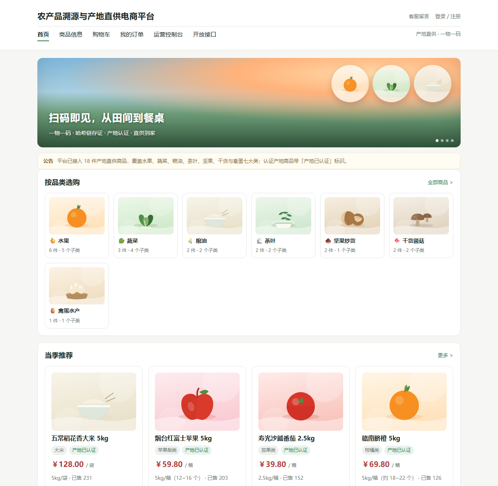
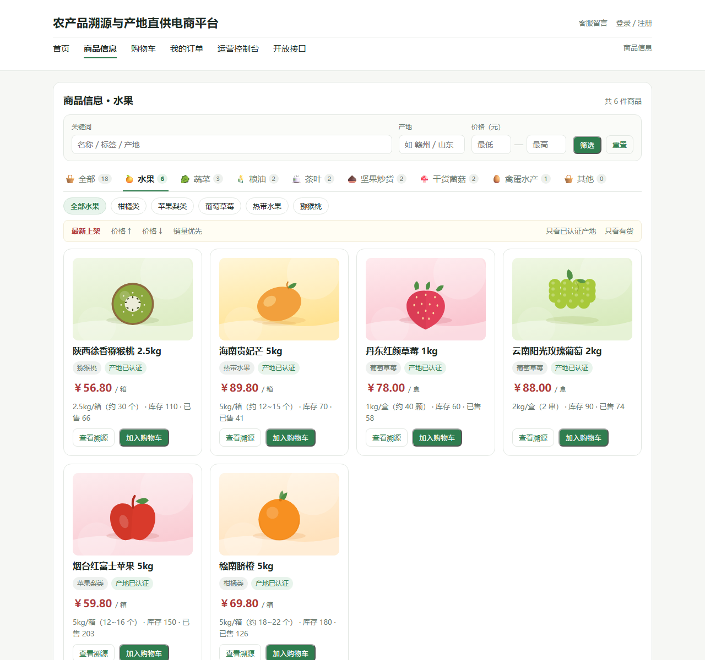
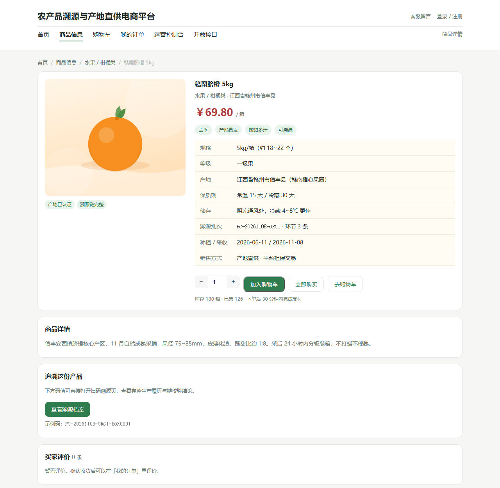
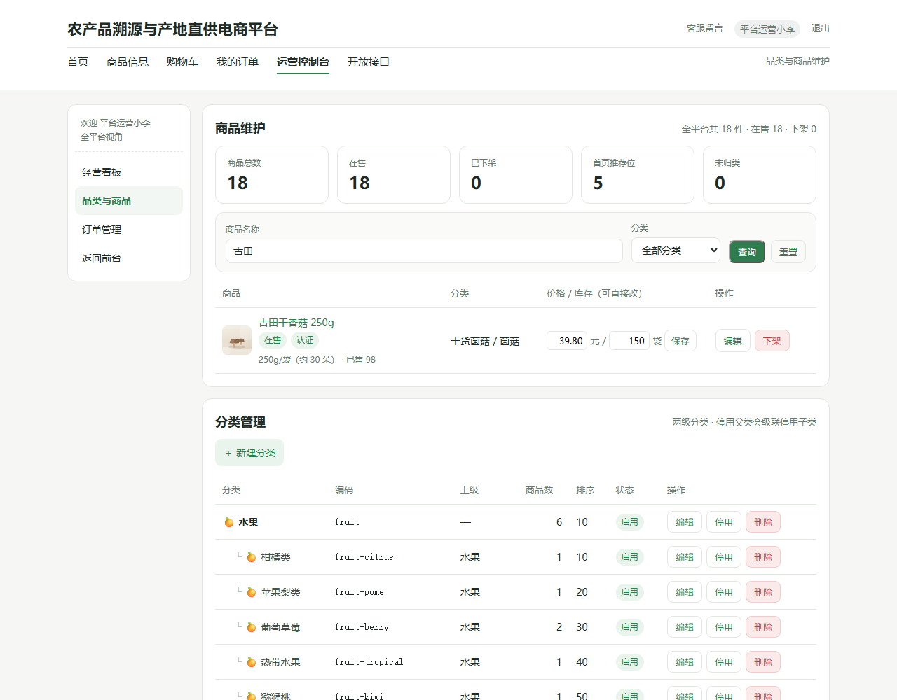

# 农产品品类与商品模块

> 对应课程报告的 UC-06（商品管理）/ UC-07（检索筛选），本文记录本次「完善农产品模块」的
> 设计取舍、数据口径、接口契约与验证结果。代码分布在 `app/catalog/`（品类域）与
> `app/trade/`（商品、检索），页面在 `app/web/`。

## 1. 目标与范围

原系统的交易域只有「上架 → 加购 → 下单」的最小闭环：商品只有名称、一段文本类目和一个价格，
消费者无法按品类浏览，运营也没法维护目录。本次补齐四件事：

| 目标 | 落地 |
|---|---|
| 新增水果、蔬菜等品类 | 8 个一级品类 + 17 个二级品类，随启动幂等写入（`app/catalog/seed.py`） |
| 分类管理 | 分类增删改查、排序、启停、层级约束，运营后台可视化维护（`/console/catalog`） |
| 信息展示 | 规格、等级、产地、保质期、储存、标签、配图结构化落库，列表/详情/后台共用 |
| 检索筛选 | 关键词（名称/描述/标签/产地）、一级或二级分类、产地、价格区间、认证、有货、四种排序、分页 |
| 数据维护 | 行内改价改库存、上下架、整表单编辑、分类换绑、推荐位 |

## 2. 领域位置与依赖

```
web 页面  ──┐
api 路由  ──┼──▶  ProductService（trade）  ──▶  CategoryService（catalog）
            │            │                          │
            │            ▼                          ▼
            └──▶  Product（product 表）  ◀──  Category（product_category 表）
                         │
                         ▼
                  Batch / Farm（溯源域，只读）
```

依赖是单向的：`trade → catalog`、`trade → trace`，`catalog` 只依赖 `trade.models` 里的商品表做计数，
不反向调用交易服务，因此不会出现循环导入（`app/catalog/service.py` 顶部只 import 模型）。

商品仍然必须挂在一条**已采收的溯源批次**上（`_assert_sellable_batch`），这是「产地直供」的数据前提，
新增品类没有放松这条约束。

## 3. 数据模型

### 3.1 `product_category`

| 字段 | 说明 |
|---|---|
| `category_id` | 雪花字符串主键（`CAT` 前缀） |
| `code` | 稳定对外编码，如 `fruit` / `fruit-citrus`；URL 与接口都用它 |
| `name` | 展示名，可改；改后商品表里的名称快照同步更新 |
| `parent_id` / `level` | 两级目录；`level` 显式落库，免得每次递归算层级 |
| `icon` / `image` | emoji 图标 + 分类配图（本地 `/static/img/categories/*.svg`） |
| `sort_no` | 同级排序，默认 +10 递增，留出手工插入空间 |
| `enabled` | 停用只影响前台可见性，不删数据 |

唯一约束：`code` 全局唯一、`(parent_id, name)` 同级唯一。
注意后者在 SQLite/MySQL 上都**对一级分类失效**（`parent_id` 为 NULL 时 NULL 互不相等），
所以 `CategoryService._assert_name_free` 在应用层再挡一次。

### 3.2 `product` 新增字段

| 字段 | 用途 |
|---|---|
| `category_id` | 分类外键；同时保留 `category` 名称快照，列表/订单/导出不必 join |
| `spec` | 规格，如「5kg/箱（约 18~22 个）」 |
| `grade` | 等级，如「一级果」 |
| `origin` | 产地文本（省市区县）；为空时详情页回落到农场所在省市 |
| `shelf_life` / `storage` | 保质期与储存方式 |
| `image_url` | 配图，只接受 `/static/` 前缀或 `http(s)://`，非法值降级为空 |
| `tags` | 逗号分隔标签，参与关键词检索；最多 6 个、去重、中文逗号归一 |
| `is_recommended` | 首页推荐位 |

金额仍以「分」存整数（`price_cents`），新增字段不涉及金额口径。

## 4. 业务规则

| 编号 | 规则 | 实现位置 |
|---|---|---|
| R1 | 最多两级分类；有子类的一级分类不能自己变成子类；分类不能挂到自己下面 | `CategoryService.create/update` |
| R2 | 停用父类级联停用子类 | `CategoryService._apply_enabled` |
| R3 | 分类下有商品或子类时禁止删除，先迁移再删 | `CategoryService.delete` |
| R4 | 停用分类不能被新商品选用（已挂的老商品保留，避免数据丢失） | `CategoryService.ensure_visible` |
| R5 | 一级分类筛选自动覆盖其全部子类商品 | `CategoryService.resolve_filter` + `ProductService.list_products` |
| R6 | 分类写操作仅平台运营；商品维护限农户（本农场）与运营 | `router.require_roles`、`ProductService.update` |

## 5. 接口

### 5.1 分类

| 方法 | 路径 | 权限 | 说明 |
|---|---|---|---|
| GET | `/api/categories` | 公开 | 默认返回两级树；`flat=true` 返回扁平列表；`include_disabled=true` 含停用项 |
| GET | `/api/categories/{id}` | 公开 | 分类详情 |
| POST | `/api/categories` | 运营 | `{code,name,parent_id,icon,image,sort_no,description}` |
| PATCH | `/api/categories/{id}` | 运营 | 部分字段更新，可换上级与启用状态 |
| POST | `/api/categories/{id}/toggle?enabled=false` | 运营 | 启停（级联） |
| DELETE | `/api/categories/{id}` | 运营 | 有子类/商品时返回 422 |

### 5.2 商品检索

`GET /api/products` 支持的参数：

| 参数 | 说明 |
|---|---|
| `keyword` | 同时匹配名称、描述、标签、产地文本 |
| `category` | 分类 code（`fruit` / `fruit-citrus`）；也兼容直接传分类名 |
| `origin` | 产地关键词，匹配商品产地与农场省/市/名称 |
| `price_min` / `price_max` | 元，服务端换算成分做区间比较 |
| `certified_only` | 只看已认证产地 |
| `in_stock_only` | 只看有货（`stock > 0`） |
| `recommended_only` | 只看首页推荐位 |
| `include_off_shelf` | 后台用，包含已下架商品 |
| `sort` | `new` / `price_asc` / `price_desc` / `sales` / `stock` |
| `page` / `size` | 分页，`size` 受 `settings.max_page_size` 限制 |

返回项在原有字段上增加：`category_id`、`category_code`、`category_path`（如「水果 / 柑橘类」）、
`spec`、`grade`、`origin`、`shelf_life`、`storage`、`image_url`、`tags`（数组）、`is_recommended`。

### 5.3 商品维护

`PATCH /api/products/{id}` 新增可改字段：`category_id`、`spec`、`grade`、`origin`、`shelf_life`、
`storage`、`image_url`、`tags`、`is_recommended`、`status`。换分类时服务端同时改 `category` 名称快照，
保证列表页不会显示旧分类。

## 6. 页面

| 路径 | 内容 |
|---|---|
| `/shop` | 关键词/产地/价格区间筛选 + 一级分类页签（带商品数）+ 二级分类 chips + 排序条 + 只看认证/有货 + 商品卡片（配图、规格、库存、销量） |
| `/shop/{id}` | 面包屑 + 主图 + 标签 + 规格/等级/产地/保质期/储存/批次属性表 + 加购与立即购买 + 同类推荐 + 评价 |
| `/` | 品类导航（8 张分类卡，带商品数）+ 当季推荐（推荐位优先，无推荐则最新上架）+ 认证产地 |
| `/console/catalog` | 商品维护（统计卡 + 筛选 + 行内改价改库存 + 上下架 + 编辑入口）与分类管理（新建、编辑、启停、删除） |
| `/console/products/{id}/edit` | 全字段编辑，含配图预览与配图选择器、推荐位开关 |

页面与 API 共用同一套 service，页面提交一律 303 重定向（PRG），错误以 `?error=` 回显。

### 界面截图

首页品类导航（8 个分类卡，带在售商品数与子类数）：



检索页（一级分类页签 + 二级分类 chips + 关键词/产地/价格区间 + 排序）：



详情页（主图 + 标签 + 规格属性表 + 同类推荐）：



后台「品类与商品」（行内改价改库存、上下架，下方为分类管理）：



## 7. 演示数据

启动时 `ensure_catalog()` 幂等补齐（判断依据：分类看 `code`、商品看名称、批次看 `batch_no`）：

- 分类：水果（柑橘/苹果梨/葡萄草莓/热带/猕猴桃）、蔬菜（叶菜/茄果/根茎/食用菌）、
  粮油（大米/杂粮）、茶叶（绿茶/红茶）、坚果炒货（核桃）、干货菌菇（笋干/菌菇）、禽蛋水产（禽蛋）、其他；
- 商品 18 件（含原有 5 件），覆盖七大品类，每件都挂一条已质检批次与溯源码；
- 产地 13 个（浙江临安、江西赣州、山东烟台、云南昆明、辽宁丹东、海南三亚、陕西眉县、
  山东寿光、河南温县、黑龙江五常、山西沁县、福建古田、浙江杭州）。

价格取 2026 年 11 月产地直供常见零售区间（元/箱、元/袋），产地与品种按公开资料整理，仅用于演示：

| 商品 | 品类 | 产地 | 价格 | 规格 | 保质期 |
|---|---|---|---|---|---|
| 赣南脐橙 5kg | 水果/柑橘类 | 江西赣州信丰 | ￥69.80 | 5kg/箱（18~22 个） | 常温 15 天 / 冷藏 30 天 |
| 烟台红富士苹果 5kg | 水果/苹果梨类 | 山东烟台福山 | ￥59.80 | 5kg/箱（12~16 个） | 冷藏 90 天 |
| 云南阳光玫瑰葡萄 2kg | 水果/葡萄草莓 | 云南昆明呈贡 | ￥88.00 | 2kg/盒（2 串） | 冷藏 10 天 |
| 丹东红颜草莓 1kg | 水果/葡萄草莓 | 辽宁丹东东港 | ￥78.00 | 1kg/盒（约 40 颗） | 冷藏 3 天 |
| 海南贵妃芒 5kg | 水果/热带水果 | 海南三亚崖州 | ￥89.80 | 5kg/箱（12~15 个） | 常温 5 天 / 冷藏 10 天 |
| 陕西徐香猕猴桃 2.5kg | 水果/猕猴桃 | 陕西宝鸡眉县 | ￥56.80 | 2.5kg/箱（约 30 个） | 冷藏 30 天 |
| 寿光沙瓤番茄 2.5kg | 蔬菜/茄果类 | 山东潍坊寿光 | ￥39.80 | 2.5kg/箱 | 常温 7 天 |
| 有机上海青 1kg | 蔬菜/叶菜类 | 浙江杭州临安 | ￥16.80 | 1kg/份 | 冷藏 4 天 |
| 温县铁棍山药 2.5kg | 蔬菜/根茎类 | 河南焦作温县 | ￥49.80 | 2.5kg/箱 | 阴凉处 30 天 |
| 五常稻花香大米 5kg | 粮油/大米 | 黑龙江五常 | ￥128.00 | 5kg/袋 | 12 个月 |
| 沁州黄小米 2.5kg | 粮油/杂粮 | 山西长治沁县 | ￥45.80 | 2.5kg/袋 | 12 个月 |
| 临安散养土鸡蛋 30 枚 | 禽蛋水产/禽蛋 | 浙江杭州临安 | ￥45.80 | 30 枚/盒 | 冷藏 30 天 |
| 古田干香菇 250g | 干货菌菇/菌菇 | 福建宁德古田 | ￥39.80 | 250g/袋 | 18 个月 |

原有 5 件商品（山核桃、山核桃礼盒、径山云雾茶、径山红茶、天目笋干）会按名称回填分类与配图，
不会重复插入。

## 8. 配图方案

演示数据使用**本地 SVG 插画**（`app/web/static/img/products/*.svg`、`categories/*.svg`），
由 `scripts/make_assets.py` 生成，每张 600×450、同构图（柔和渐变底 + 白色山丘 + 主体农产品），
同一套视觉贯穿首页、列表、详情与后台。

为什么不用实拍图：本次尝试过维基共享资源、Unsplash、Pexels 三个来源，
在当前网络环境下分别遇到 TLS 握手失败与 429 限流，无法稳定批量拉取；
而离线评审时外链图必然裂图。矢量图 1~2KB、无色差、不依赖 CDN，更适合课程交付。

替换成实拍图只需要两步：
1. 把图片放到 `app/web/static/img/products/`（或任意可访问的 https 地址）；
2. 后台「品类与商品 → 编辑 → 商品配图」填入路径/链接（`image_url` 只接受 `/static/` 与 `http(s)://`）。

## 9. 兼容与升级

- **老库补列**：`create_all` 不会给已有表加字段，`app/db/migrate.py::ensure_columns` 用声明式清单
  做 `ALTER TABLE ADD COLUMN`（只增不删、幂等），`init_db()` 里自动执行；
- **老数据回填**：`backfill_products()` 按名称把历史商品挂到分类、补配图，已填值不覆盖；
- **接口兼容**：`/api/products`、`/api/products/categories`、`ProductCreate.category` 仍可用，
  原有 85 个用例未改动全部通过；
- **生产 DDL**：`sql/schema_mysql.sql` 追加 `product_category` 与 `product` 建表语句。

## 10. 验证结果

```text
pytest -q                 → 102 passed（新增 17 个品类/商品用例）
ruff check app tests scripts → All checks passed
```

新增用例（`tests/test_catalog.py`）覆盖：两级分类约束、同级重名拦截（含 NULL 父类的坑）、
停用级联、删除守卫、农户不能建分类、父类筛选覆盖子类、标签/产地关键词、价格与有货筛选、
换分类时名称快照同步、配图白名单、下架后前台隐藏且不可加购、运营可改任意商品、
`/shop` 与 `/console/catalog` 页面渲染、`ensure_catalog` 幂等。

> 报告 5.2.3 的「人工修改点」可补一条：分类唯一约束对一级分类失效，需应用层补校验。

## 11. 已知限制

| 项 | 现状 | 下一步 |
|---|---|---|
| 配图 | 本地 SVG 插画 | 接对象存储 + 图片上传接口，运营传实拍图 |
| 分类层级 | 固定两级 | 如需三级，把 `level` 校验改成「最大深度」并按子树算层级 |
| 商品新建 | 后台只做维护，上架仍走 `POST /api/products`（需选批次） | 增加「选批次 → 填商品」的向导页 |
| 分类删除 | 有商品/子类直接拒绝 | 支持批量迁移到目标分类后再删 |
| 检索 | SQL `LIKE`，无分词与拼音 | 数据量上来后接全文索引（MySQL FULLTEXT / ES） |
