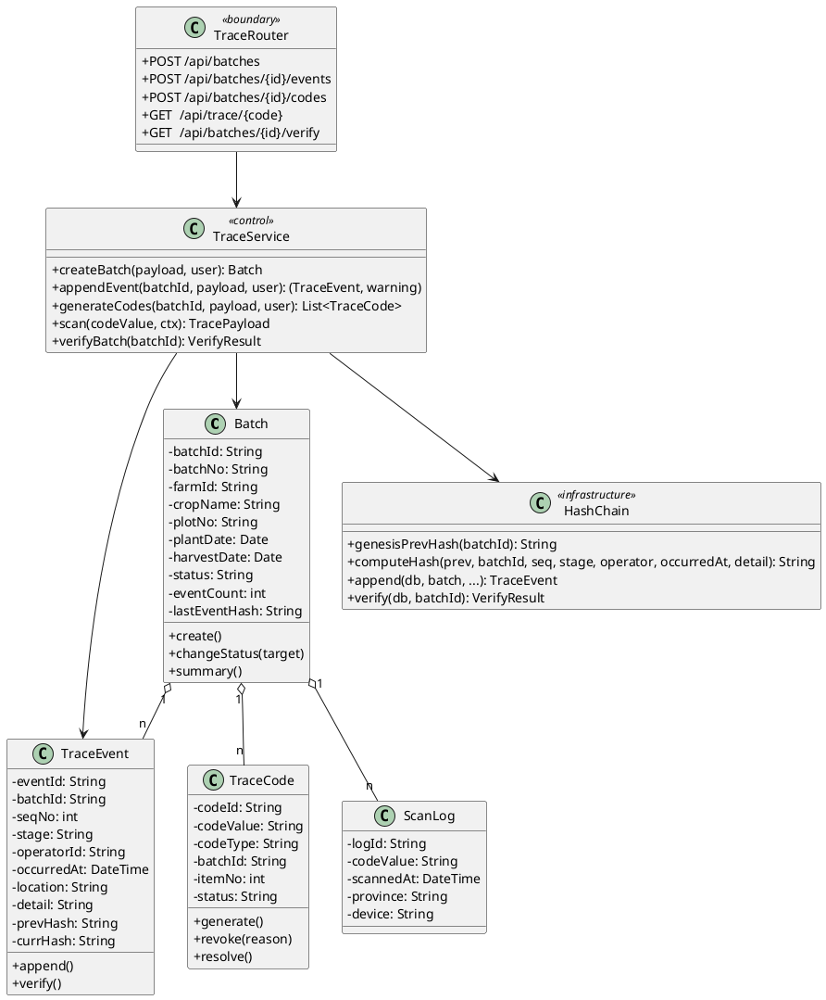
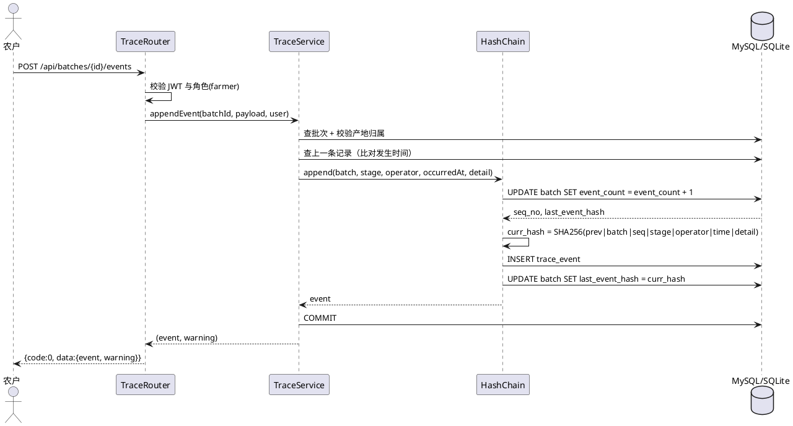
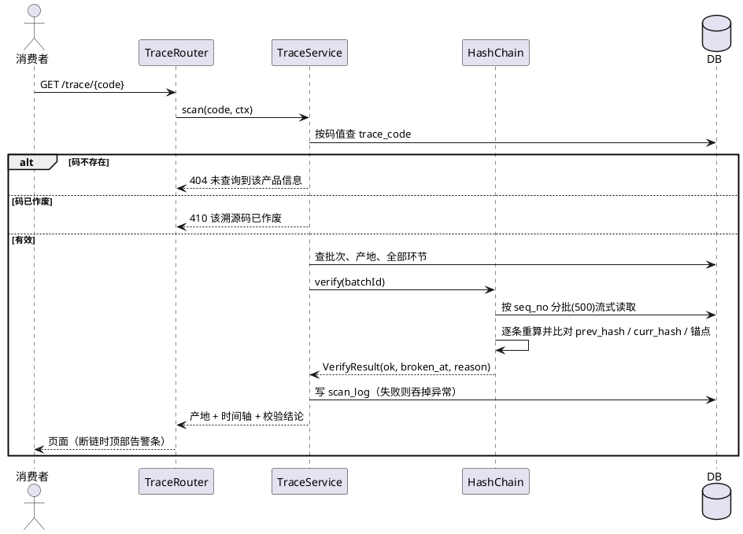

# 设计说明（溯源链域）

## 1. 分层与模块

```
app/
├── core/      配置、错误码、统一响应、JWT、雪花号、依赖注入   ← 公共基础（组长）
├── db/        引擎、会话、建表、种子数据                     ← 公共基础（组长）
├── common/    User / Farm / Role 跨域最小契约                ← 公共基础（组长）
├── trace/     溯源链域（UC-01~UC-05）
│   ├── models.py    实体：Batch / TraceEvent / TraceCode / ScanLog
│   ├── schemas.py   出入参（Pydantic v2）
│   ├── chain.py     HashChain 组件：append / verify
│   ├── service.py   TraceService：用例编排与事务边界
│   ├── router.py    Boundary：路由、鉴权、统一响应
│   └── qrcode_export.py  二维码压缩包
├── account/   登录与令牌签发（其余由王×× 扩展）
└── web/       扫码页模板与样式
```

依赖方向严格单向：`router → service → chain/models`，`chain` 不感知业务，只认字段。
后续新增环节类型（如"仓储"）只改 `Stage` 常量与前端展示，链条与校验逻辑零改动——
这就是把存证能力下沉到基础设施层的收益。

## 2. 类图（PlantUML）



## 3. 顺序图：录入环节（UC-02）



关键点：**序号分配与摘要计算在同一个事务里**，且序号来自数据库原子自增；
`UNIQUE(batch_id, seq_no)` 是兜底，冲突时回滚重试（最多 5 次）。

## 4. 顺序图：扫码溯源（UC-04）



## 5. 批次状态机

```
draft ──> growing ──> harvested ──> qualified ──> closed
  └──────────────────> harvested
```

- 只允许上图方向，回退或跳步返回 422；
- `closed` 后禁止追加环节记录；
- 状态变更本身不写入溯源链（链只记录业务环节），避免"管理动作"污染履历。

## 6. 并发一致性方案（三轮迭代后的结论）

| 方案 | 问题 | 是否采用 |
|---|---|---|
| `SELECT MAX(seq_no)+1` | 并发下取到同一序号，链断裂 | ❌ |
| Python `threading.Lock` | 多 worker 失效，且锁住整个校验流程 | ❌ |
| **DB 行级原子自增 + 唯一索引 + 重试** | 依赖数据库事务，跨进程有效 | ✅ |

具体实现（`app/trace/chain.py::HashChain.append`）：

1. `UPDATE batch SET event_count = event_count + 1 WHERE batch_id = ?` —— 拿到行锁与序号；
2. 读回 `event_count`、`last_event_hash` 作为 `seq_no` 与 `prev_hash`；
3. 计算 `curr_hash`，`INSERT trace_event`，更新 `last_event_hash`；
4. 提交；若撞唯一索引则回滚并重试（指数退避 10ms 起）。

SQLite 下第 1 步即取库级写锁，效果等同；MySQL 下是 InnoDB 行锁，不同批次互不阻塞。

## 7. 关键取舍

| 取舍 | 选择 | 理由 |
|---|---|---|
| 校验失败抛异常还是返回结果 | 返回 `VerifyResult` | UC-04 要求先展示记录再告警，异常会导致整页 500 |
| 一次性读全链还是分批 | 分批 500 条流式 | 5000 条记录的链不占满内存，P95 更稳 |
| 码值随机还是派生 | 批次号 + 序号派生 | 幂等、可人工核对；随机串需额外去重表 |
| 作废是删除还是置状态 | 置 `revoked` + 留痕 | 已印刷的码必须能解释"为何失效" |
| 时间倒挂阻断还是放行 | 放行 + 预警 | 补录是真实场景，阻断会导致数据丢失 |
| 扫码日志同步还是异步 | 同会话尽力写 + 吞异常 | 课程量级够用；接口预留了换 MQ 的位置 |
